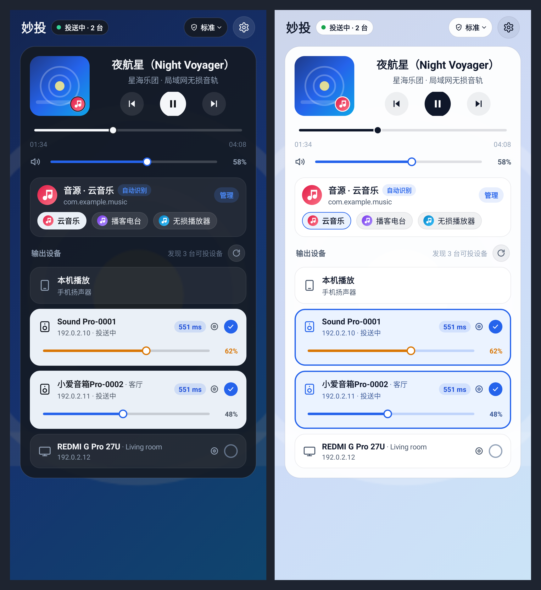
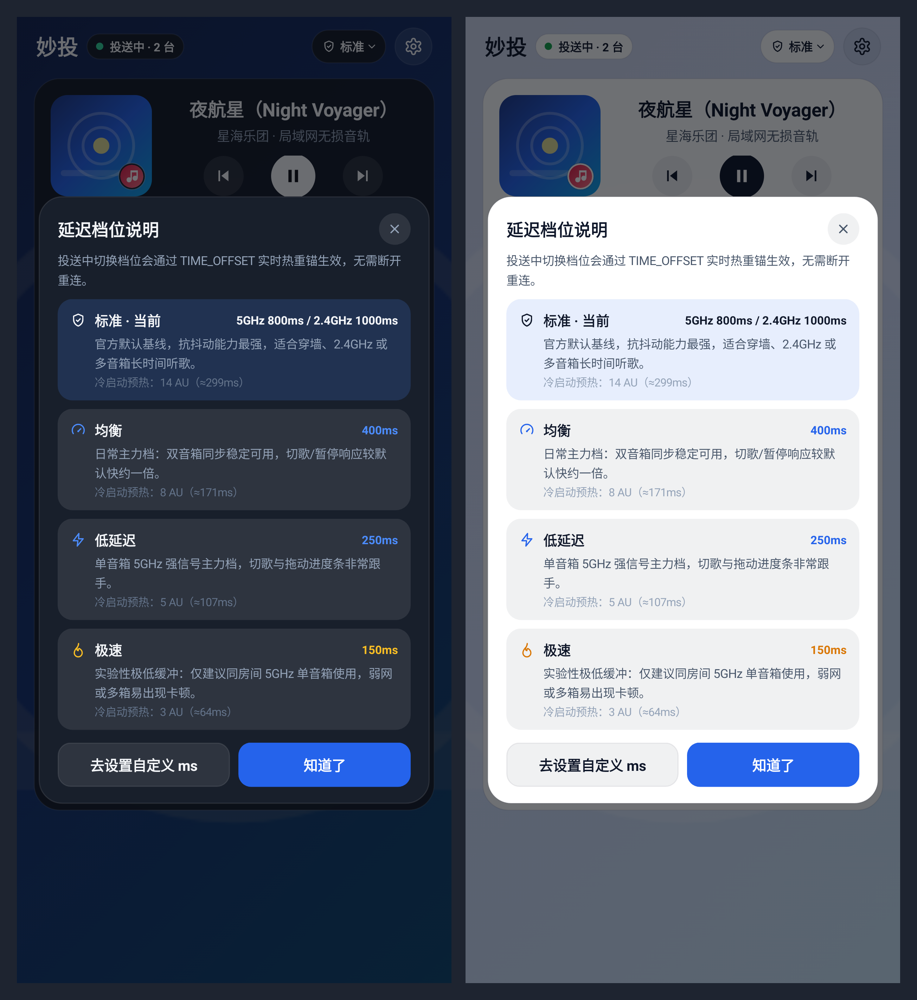
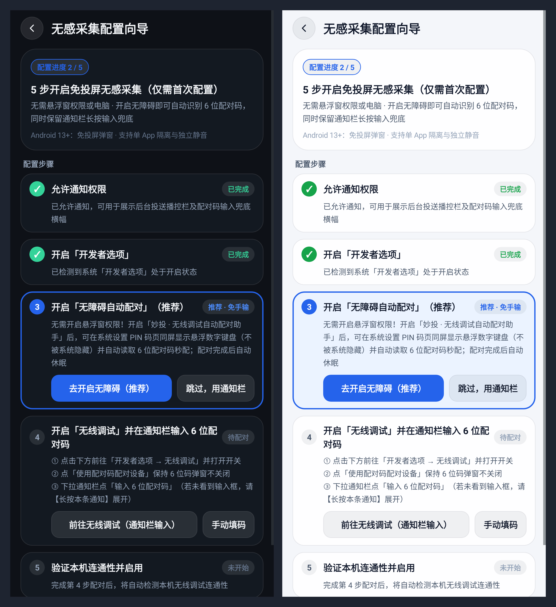

# 妙投（MiaoCast）：用 Rust + Android 打造纯局域网多音箱 MiPlay 投音工具

家里买了几台小米 / 小爱音箱，想把手机里的音乐无线投过去听，结果真正用起来才发现处处受限：

1. **换了非小米手机，原厂「小米妙播」就用不了**：华为、三星、OPPO、vivo、一加、Pixel 等安卓手机没有原厂妙播入口，只能退回老旧蓝牙。
2. **蓝牙听歌体验差，还只能连 1 台音箱**：人拿着手机走出客厅就断连卡顿，音频经过蓝牙有损压缩，更没法让客厅、卧室、书房的多台音箱同时同步放歌。
3. **蓝牙 / 整机投屏极易「社死串音」**：客厅音箱正放着歌，微信语音、信息流短视频、系统通知音全被一并广播到全屋音箱。
4. **切歌延迟高、刷视频还抢焦点**：在手机上随手点开一条短视频，客厅音箱里好好的音乐立刻被暂停。

为了彻底解决这几个痛点，我做了一款面向家庭局域网的第三方 MiPlay 音频投送工具——**妙投（MiaoCast）**。

它目前先以**免费、无广告**的形式放出 Android 10+ 安装包和跨平台只读诊断命令行工具 `miaocast-cli`，方便大家拿手里的安卓手机和小米音箱一起实测兼容；仓库整理收尾后，计划按 `AGPL-3.0-only` 正式开源。

> 📦 **立即体验**：
> - **产品官网（支持中 / 英 / 日三语）**：[https://jasirvoriya.github.io/miaocast-releases/](https://jasirvoriya.github.io/miaocast-releases/)
> - **Android 安装包（APK）与 `miaocast-cli` 下载**：[GitHub Releases（miaocast-releases）](https://github.com/JasirVoriya/miaocast-releases/releases)
> - **在线交互式架构浏览器**：[https://jasirvoriya.github.io/miaocast-releases/architecture.html](https://jasirvoriya.github.io/miaocast-releases/architecture.html)

## 一分钟看懂妙投

下面是一段 62 秒无旁白实机风格演示，直观展示单 App 音频隔离、多台小米 / 小爱音箱毫秒级同频、4 档延迟实时热切换以及 Android 13+ 免 Root 无感采集体验：

<video controls playsinline preload="metadata" poster="./assets/miaocast-promo-poster.jpg" style="width: 100%; border-radius: 12px; margin: 12px 0; box-shadow: 0 8px 24px rgba(0, 0, 0, 0.12);">
  <source src="https://jasirvoriya.github.io/miaocast-releases/assets/video/miaocast-promo.mp4" type="video/mp4">
  当前浏览器暂不支持内嵌视频播放，可直接前往 <a href="https://jasirvoriya.github.io/miaocast-releases/#video">产品官网观看演示视频</a>。
</video>

*(注：演示视频与下方截图中的设备名和局域网 IP 均为匿名占位数据。)*

## 和常见投音方案有什么区别

| 对比维度 | **妙投（MiaoCast）** | 普通蓝牙连接 | 原厂小米妙播 | 系统整机投屏 / 录屏 |
| :--- | :--- | :--- | :--- | :--- |
| **手机品牌限制** | ✅ **任意 Android 10+ 手机**（iOS 规划中） | ✅ 不限品牌 | ❌ 仅限部分小米 / Redmi | ✅ 不限品牌 |
| **多音箱全屋同频** | ✅ **协议层最多 63 台毫秒级同步**，播放中随时加减 | ❌ 通常仅 1 台 | ✅ 支持多台 MiPlay 设备 | ❌ 单台或延迟大 |
| **单 App 隔离不串音** | ✅ **严格只投选定音乐 App**，微信/通知绝不外放 | ❌ 整机声音全部外放 | ✅ 支持指定媒体源 | ❌ 全系统声音与画面广播 |
| **刷视频不暂停音箱音乐** | ✅ **Android 13+ 无感模式支持双区焦点隔离** | ❌ 刷视频直接抢断音乐 | ⚠️ 视系统版本而定 | ❌ 无法隔离 |
| **覆盖距离与音质** | ✅ **家庭 Wi-Fi 覆盖即不断连**（48kHz 256kbps AAC） | ❌ 穿墙易断连、蓝牙压缩 | ✅ Wi-Fi 局域网传输 | ⚠️ 带宽高、常驻录屏红点 |
| **延迟实时热切换** | ✅ **4 档（150ms–1000ms）+ 自定义 `ms` 免重连秒切** | ❌ 不可调 | ❌ 不可调 | ❌ 不可调 |
| **隐私与账号依赖** | ✅ **纯局域网、零云端、免登录小米账号、免费无广** | ✅ 本地直连 | ❌ 绑定小米账号与生态 | ⚠️ 依厂商服务而定 |

## 核心功能与真实界面一览

### 1. 打破品牌限制 + 全屋多音箱毫秒级同频

只要手机与小米 / 小爱音箱连在同一家庭 Wi-Fi 下，打开妙投就能自动发现局域网内支持 MiPlay 的音箱，并自动过滤掉不相关的局域网杂项设备。

主界面直接显示每台音箱的房间名、实时播放延迟（`ms`）与独立音量条。听歌途中想给书房加一台音箱，或者关闭卧室音箱，直接勾选 / 取消勾选即可，全程不断歌。

### 2. 4 档播放延迟免重连热切换

传统局域网投音往往在「抗弱网抖动」和「切歌跟手」之间二选一。妙投在顶部内置了延迟档位胶囊，投送过程中无需断开重连就能实时重锚切换：

- **标准（5GHz 800ms / 2.4GHz 1000ms）**：抗穿墙弱网抖动能力最强，适合多音箱长时间稳定听歌；
- **均衡（400ms）**：日常主力档，双音箱同步稳定，切歌和暂停响应比默认快约一倍；
- **低延迟（250ms）**：单音箱 5GHz 强信号场景下，切歌与拖动进度条非常跟手；
- **极速（150ms）**：实验性极低缓冲，适合同房间 5GHz 单音箱追求极致响应（也支持在设置里自定义 `ms`）。

### 3. Android 13+ 内置无线调试「无感模式」：免 Root、免电脑、免 Shizuku

- **标准投屏模式**兼容 Android 10+ 所有机型，零配置开箱即用，严格按单个 App UID 捕获音频。
- 如果你是 **Android 13+** 用户，可以在 App 内按 **4 步内置无线调试向导**输入一次 6 位配对码（纯手机本机直连，无需 Root、无需电脑、无需安装 Shizuku），解锁更接近原厂的**无感采集模式**：
  - 告别每次点击投送都要确认的「开始录制或投射」系统弹窗，也不常驻系统投屏状态提示；
  - **真·单 App 本机静音**：仅静音正在投送的那一个音乐 App 的手机本地声音，手机其他 App 照常从手机扬声器发声；
  - **双区音频焦点隔离**：客厅音箱放着网易云 / Apple Music / Spotify 的同时，你在手机上照常刷抖音、看 B 站、听微信语音，互不抢焦点、互不暂停。

## 背后的工程架构拆解

相比单纯堆一个能响的 Demo，妙投从第一天就是按**跨端共享核心 + 确定性实时音频流水线**来设计的：

1. **L1 共享纯 Rust 核心（零异步运行时）**
   - 协议发现（mDNS）、TCP `8899` 控制链路与双认证（Legacy 的 `MD5 + HMAC-SHA1` 与 Safety 的 `OPack + 双向 HMAC + 链式 AES-128-CBC` 严格隔离）、WFD RTSP、多箱并发协调器与设备目录状态机全部下沉在纯 Rust 核心 `core/`。
   - 媒体同步引擎刻意**不引入异步运行时**，完全由确定性实时线程 + 有界 `sync_channel` 驱动：通过单调 `EPOCH` 时基、UDP 40B `TimerServer` 时钟主与 `OffsetBarrier` 预读对齐实现全组同频；运行时支持 `TIME_OFFSET` 热重锚切档，慢端满队时单端剔除，绝不拖垮整组播放。
2. **四条正交数据流向**
   - 媒体流（单 UID `AudioRecord` 48kHz → `MediaCodec` 256kbps 裸 AAC → 21.333ms 节拍 → 每台接收端独立 `ADTS → PES → MPEG-TS → RTP PT=33` 封装）、控制流、时钟流、发现遥测流彼此解耦，单进程零 IPC 拷贝。

3. **严格 Fail-Closed 单 App 捕获边界**
   - 启动捕获前实时校验目标包同用户、非共享 UID 与 SHA-256 包签名，绝不静默降级为全系统录屏或麦克风收音；内置 `PcmProbe` 有声探测锁定，消除切歌静音间隙手机和音箱短暂「双出声」的毛刺。
   - 无感模式下通过本机无线 ADB（mDNS + SPAKE2 / TLS 1.3）拉起同应用 `uid=2000` 辅助进程，走 `127.0.0.1` 环回与一次性 256-bit Token 通信，在单一 `AudioPolicy` 上同时挂载单 App `AudioMix` 与 `AudioPolicyFocusListener`。
4. **双端原生与 iOS 预留**
   - Android 端使用 Kotlin + 16KB ELF 页对齐 JNI `.so`（最低真实兼容 Android 10 / API 29）。
   - iOS 端已经同步维护了 C11 头文件（`miaocast_core.h`）与 `XCFramework` 构建脚本，以及双端共享的视觉 Token 规范；原生 SwiftUI + ReplayKit 客户端正在规划推进中。
5. **只读终端诊断工具 `miaocast-cli`**
   - 随版本提供桌面端 `miaocast-cli`，支持 `discover` 扫描局域网音箱与只读 `inspect`（仅发送 `GET_*` 并以 TCP shutdown 优雅退出，绝不发 `CLOSE` 打断正在播放的音乐），方便开发者和玩家排查不同音箱固件的协议差异。

如果你想顺着代码模块逐层追踪上下游调用关系，可以直接打开零依赖的 **[在线交互式架构浏览器](https://jasirvoriya.github.io/miaocast-releases/architecture.html)**，点击任意模块即可高亮它的全部上游输入和下游消费者。

## 3 步快速上手

1. **下载安装**：前往 **[GitHub Releases（miaocast-releases）](https://github.com/JasirVoriya/miaocast-releases/releases)** 下载最新的 `miaocast-*-arm64-v8a.apk`（要求 Android 10+）。
2. **连同一家庭 Wi-Fi**：确认手机和小米 / 小爱音箱在同一个路由器局域网下，打开妙投等待几秒即可自动列出可用音箱。
3. **选音源、选音箱开播**：点选常用音乐 App（或先放歌让自动识别接管），勾选一台或多台音箱即可同频播放；Android 13+ 推荐在「设置 → 采集引擎」里按向导开启无感模式。

## 诚实工程边界与兼容共建

这个项目一直坚持一个原则：**只声明有代码或实机证据支撑的能力，不把编译通过等同于全机型兼容**。有几点边界提前说清楚：

- **不绕过系统捕获限制**：若极少数第三方 App 在清单里显式声明 `allowAudioPlaybackCapture="false"`，系统拒绝捕获，妙投尊重系统规则，不会尝试绕过。
- **区分标准模式与无感模式的静音边界**：未开启无感模式（普通应用权限）时，Android 公开 API 不支持单独静音某一个第三方 App 而不影响媒体音量，因此提供「全局媒体静音（默认）」与「保留本机出声」两种策略；真·单 App 本机静音与双区音频焦点隔离需要在 Android 13+ 开启无感模式，且实际路由效果以具体机型 ROM 实测为准。
- **不同音箱固件与厂商 ROM 存在差异**：例如各厂商后台冻结策略，以及部分老款音箱（如小爱音箱 Pro `LX06` 晚加入扩组）存在的固件协议差异，都在公开仓的 [设备兼容矩阵](https://github.com/JasirVoriya/miaocast-releases/blob/main/docs/COMPATIBILITY.md) 和 [已知限制文档](https://github.com/JasirVoriya/miaocast-releases/blob/main/docs/LIMITATIONS.md) 中如实记录。
- **隐私与网络边界**：音频发现与投送 100% 留在家庭局域网内，零云端服务器、零小米账号登录、零统计上报；应用内置的新版本检查仅拉取公开仓只读 `update.json`（强制 HTTPS + SHA-256 + APK 签名校验），也可在设置里一键关闭实现 100% 零外网请求。

如果你手头正好有小米 / 小爱音箱和不同品牌的安卓手机，欢迎下载试用，并到 **[miaocast-releases Issues](https://github.com/JasirVoriya/miaocast-releases/issues/new)** 回报你的「手机型号 + 音箱型号 + 测试结果」（能用和踩坑都非常宝贵）。后续代码整理完成后，也会第一时间在这篇博客和仓库同步正式开源动态。
